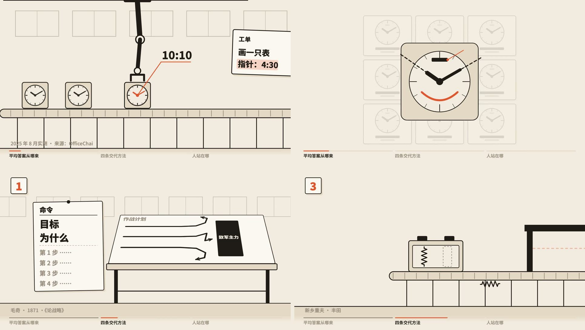
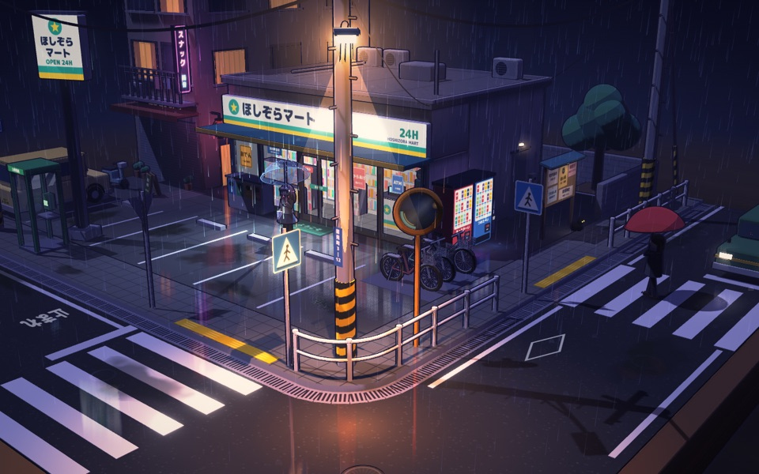

# 成片工坊 · video-forge

[](https://claude.com/claude-code)
[](https://remotion.dev)
[](LICENSE)
[](https://hongxiang01.github.io/video-forge/)
[](LICENSE-CONTENT)

**一句话想法进来，画风视频出去。** video-forge 是一个 [Claude Code](https://claude.com/claude-code) skill，加上一个作品库，负责画风短片、音乐 MV、科普动画和三维微缩场景。画面默认用代码绘制（Remotion / canvas / three.js）；角色原画可以让豆包照同一张设定图画；真人、3D 这类代码画不出来的画风，由它出剧本、资产表和逐镜提示词，交给生成式视频工具。

它不自己发明画风和动效，而是当**导演和关卡**：
- 先追问到每个细节，画风、分镜确认后才开工；
- 生产交给现成的开源库（[lemo-opuscar](https://github.com/lemomo-ai/lemo-opuscar) 66 种画风、[huashu-art-motion](https://github.com/alchaincyf/huashu-art-motion) 艺术风格、[video-talkcraft](https://github.com/Vincentwei1021/video-talkcraft) 动效卡、[anything2explainer](https://github.com/hongxiang01/anything2explainer) 讲解片流水线）；
- 做完由独立评委按**你定的标准**逐条审片，最后归档、复盘。

[](https://hongxiang01.github.io/video-forge/)

**在线观看作品和画风样片墙：<https://hongxiang01.github.io/video-forge/>**

## ✨ 亮点

- **不许一句话开工**：场景、人物、情绪、结构、声音、禁忌、视频类型与评审标准，逐项追问，每轮贴需求卡。模糊词（"高级""温馨"）一律换成具体画面再定。
- **先确认再生产**：需求卡 → 评审标准卡 → 画风（样片墙）→ 风格卡 / 风格帧 → 分镜联系表 → 生产，关卡不跳。
- **一张总目录选所有素材**：237 条，覆盖 118 种画风、108 张动效卡、9 种解说语法和自己的画风方案，标好来源、许可、本机有没有（[index/catalog.md](index/catalog.md)）。
- **标准由用户定**：按视频类型（科普、叙事动画、MV、特效、画风氛围、微缩交互、广告）给出默认检查项，你挑出必须项、补充自己的标准。每条都要能在画面里找到证据，评委只判"通过 / 部分 / 不通过"，不出没有依据的分数（[skill/references/review-standards.md](skill/references/review-standards.md)）。
- **自己的东西越攒越多**：每个作品都留下需求卡、风格卡、分镜、评分记录和复盘；能复用的路子沉淀成 `recipes/`，画风沉淀成 `my-styles/`。

## 🎞 作品

| 作品 | 类型 | 说明 |
|---|---|---|
| [违背的青春](works/weibei-youth-mv/) | 音乐 MV · 黑板粉笔定格动画 · 2:27（无字版 + 歌词版） | 长大的"我"一格一格守着规矩，当年骄傲的少年留在彩色跳房子里，目送他走远。角色是豆包照同一张设定图画的粉笔原画，切开后按拍子换张；歌词用粉笔逐字写出、唱完擦掉。前后八版：[复盘](retros/2026-11-06-weibei-youth-mv.md)，做法沉淀成[方案](recipes/chalk-pose-mv.md)。音乐是薛之谦《违背的青春》，版权归原权利人，非商业二次创作 |
| [最后一碗面](films/last-bowl/) | 叙事微短片 · 80 年代赛璐璐 + 三渲二 · 45 秒 | 深夜面馆，老师傅关门前的最后一碗面。有手的镜头用三维骨骼手 + 卡通渲染，画面仍是平涂赛璐璐；前后六版，[复盘：为什么改了六版](retros/2026-11-05-last-bowl.md) |
| [《最后一碗面》幕后](works/last-bowl-making-of/) | 幕后科普 · 发布会大屏 · 2:48 | 逐段讲第一版的问题、平面画法为什么改不动、三渲二解决了什么、AI 在哪里自信地看错，最后放第六版。Remotion，一份时间轴管切片、出图、混音。[分镜与出处](works/last-bowl-making-of/script.md) |
| [AI 到底该怎么用](works/ai-howto/) | 科普讲解 · 纸本风格 · 3:46 | 用一条工厂流水线讲"管人和用 AI 是同一套逻辑"：毛奇的作战计划、贝索斯的单向门、新乡重夫的弹簧小碟、PDCA。Remotion 17 个镜头，4 个 agent 并行构建，两轮评审。[源码](works/ai-howto/video/) |
| [雨夜便利店街角](works/rainy-corner-diorama/) | 三维微缩 · 三渲二 | three.js 可拖拽的雨夜街角模型，三渲二描边加霓虹倒影。[在线版](https://claude.ai/artifact/EihBG86XhJRQmKkUZ8wC56) |

 

## 🚀 快速开始

```bash
git clone git@github.com:hongxiang01/video-forge.git ~/video-forge
ln -s ~/video-forge/skill ~/.claude/skills/video-forge   # 让 Claude Code 加载 skill
bash ~/video-forge/bootstrap.sh                            # 拉取核心依赖（lemo-opuscar、huashu-art-motion）
bash ~/video-forge/bootstrap.sh check                      # 查看哪些依赖已就位
```

然后在 Claude Code 里说「做个视频」「做 MV」「做个微缩场景」「用 XX 方案做一个…」，或者「不知道做什么画风」。

> 网络慢或有代理时，`bootstrap.sh` 会自动绕开代理，GitHub 走 codeload 直连。lemo-opuscar 是稀疏克隆：用到哪个画风才拉哪个（`git -C ~/mv-xue/lemo-opuscar sparse-checkout add styles/<slug>`）。

## 🧭 一条片子怎么做出来

```
追问 → 需求卡 + 评审标准卡（用户确认）
     → 画风：查总目录 / 样片墙 → 风格卡 → 1–3 张风格帧（真实绘制代码）
     → 设定卡（有人物、地点、物件时）→ 分镜联系表（用户确认）
     → 生产（按产线：画风视频 / MV / 科普 / 微缩；大任务按职责分给多个 agent）
     → 独立评委逐条判定 → 只改不通过的项（≤3 轮，每轮给用户看）
     → 归档到 works/ + retros/，能复用的路子写成 recipes/
```

## 📦 仓库里有什么

```
video-forge/
├── skill/                 # Claude Code skill（软链到 ~/.claude/skills/video-forge）
│   ├── SKILL.md           # 总入口：铁规矩 + 步骤
│   └── references/        # 追问清单、卡片模板、评审与评审标准库、各产线、分工、排错
├── index/                  # 总目录（build_index.py 从各库自动生成）
├── deps.json              # 外部依赖清单：地址、锁定版本、许可、用到什么
├── bootstrap.sh           # 一键拉取外部依赖
├── recipes/                  # 可复用的生产方案：三渲二微缩、黑板粉笔定格 MV
├── my-styles/              # 自己沉淀的画风卡
├── works/<slug>/         # 需求卡、风格卡、分镜、源码、评分记录
├── retros/                  # 每次做完的复盘，skill 的进化日志
├── tools/                   # 自己写的工具：豆包生图自动化（doubao/）、代码作曲（music/）
├── gallery/                # 66 种 lemo 画风样片墙（index.html 本地打开）
├── films/                 # lemo 产线的生产目录
└── vendor/                  # 外部依赖下载到这里（不进仓库）
```

**仓库的原则：只收自己的东西，其余写索引。** 别人的仓库不复制进来：在 `deps.json` 登记，需要时用 `bootstrap.sh` 拉取。从外部库真正用上的部分，用自己的话和参数重写后放进来，并注明来源。用到什么再往里写，暂时不用的不补。大文件（成片、配音、渲染缓存）只留在本机。

## 📄 许可

- 本仓库的**代码**（skill 脚本、`index/`、`bootstrap.sh`、作品源码）：[MIT](LICENSE)。
- 本仓库的**内容**（作品文案、分镜、复盘、画风卡、截图）：[CC BY 4.0](LICENSE-CONTENT)。
- 作品里引用的歌曲、录音和歌词（《违背的青春》，薛之谦词曲）版权归原权利人，不在 CC BY 4.0 范围内；粉笔引擎取自 lemo-opuscar（MIT），署名见 `works/weibei-youth-mv/chalk/CREDITS`。
- `gallery/` 的影片截图来自 [lemo-opuscar](https://github.com/lemomo-ai/lemo-opuscar)（影片 CC BY 4.0，代码 MIT）。
- 外部依赖各自保留原许可，见 `deps.json`。其中 video-talkcraft、anything2explainer 是 **PolyForm Noncommercial**：仅限非商业使用，代码不收进本仓库；商用需先取得原作者授权。

## 🙏 致谢

- [LemoLab · lemo-opuscar](https://github.com/lemomo-ai/lemo-opuscar)：66 种画风与渲染内核、样片墙素材
- [花叔 · huashu-art-motion](https://github.com/alchaincyf/huashu-art-motion)：艺术风格配方卡与解说动画语法
- [Vincent Wei · video-talkcraft](https://github.com/Vincentwei1021/video-talkcraft)：口播动效卡、镜头与质检方法
- [anything2explainer](https://github.com/hongxiang01/anything2explainer)：讲解片流水线、文案写法与配音时间轴
- [mv-director](https://github.com/Yari-tuber/mv-director)：音乐 MV 产线
