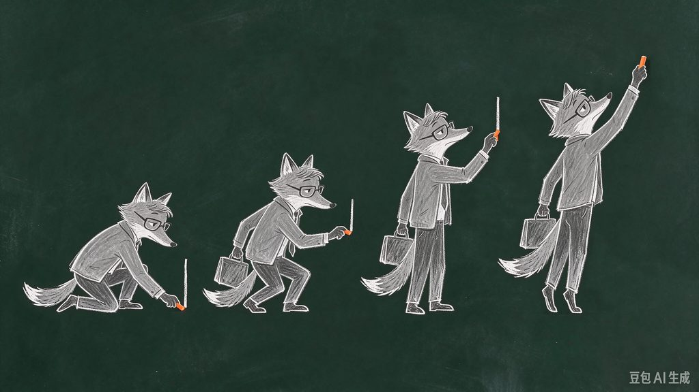

# 方案：黑板粉笔定格 MV（姿势原画换张）

> 一句话：角色是豆包照着同一张设定图画出来的粉笔原画，按拍子一张一张换，像黑板上的定格动画；歌词用粉笔一个字一个字写出来，唱完就擦掉。整块黑板就是整个世界。

来源：《违背的青春》MV 第 7 版（2026-11-06），成片 `works/weibei-youth-mv/chalk/out/chalk_v7_lyrics.mp4`，作品库里有压缩预览。前 6 版走过的弯路见复盘 `retros/2026-11-06-weibei-youth-mv.md`。

## 1. 适用

- **适合做**：抒情歌 MV，有一两个角色要"演"大动作（走、跳、跪、起身、伸手、递东西、转身走远）；回忆、校园、成长、遗憾一类题材；要逐字卡拍的歌词版。
- **不适合做**：
  - 快歌、舞曲。每拍都要换姿势，原画张数会爆炸。
  - 手部精细操作，比如按弦、写字特写。
  - 要真人质感的片子，改走 Muse 生成，见 `skill/references/pipeline-mv.md` 路线 B。
- **产线**：MV（`skill/references/pipeline-mv.md` 路线 A）。
- **输出**：1920×1080、30 fps，出无字版和歌词版两条。渲染可复现：同一时刻的画面逐像素一致，所以改哪段就只重渲哪段。

## 2. 画风

- **来源画风**：`my-styles/chalkboard-chalk` 定色值、线条和动态；lemo-opuscar `chalkboard` 引擎负责粉笔笔画的烘焙、书写和擦除，颗粒遮罩每 2 帧换一套，静止的线条也在"呼吸"。
- **颜色就是时间**：白、灰粉笔代表现在、大人、规矩；彩色粉笔代表青春、少年、回忆。
- **角色**：每个角色先由豆包画一张全身设定图（3/4 侧身朝右，站直，手离开身体），之后**所有姿势都拿这一张当参考图**。头和身子出自同一张画，所以不会"头是头、身是身"。
- **禁区**：
  - 代码拼出来的身子（管子、圆角块）；
  - 豆包画的头配代码画的身子；
  - 拿骨骼去掰大动作，会出现肩膀裂开、脚尖乱指；
  - 平滑渐变的雾；
  - 全屏闪白、震屏。

## 3. 追问补充

| 项 | 为什么要问 | 默认值（用户说「你定」时） |
|---|---|---|
| 角色是谁、有几个 | 每个角色要一张全身设定图、十几组姿势 | 1–2 个，比如大人和少年两个年纪 |
| 认人点 | 同一个人两个年纪、两种画法，要一眼认出来 | 黑框眼镜 + 一撮斜刘海 |
| 真人还是动物 | 用户嫌真人"呆板、不真实"时改拟人动物 | 拟人狐狸 |
| 每镜的动作 | 决定要画多少组姿势（一组 4 张） | 每镜 1 组；30 镜左右约 30 组，加 5–6 组道具和场景 |
| 要不要歌词版 | 用户发抖音习惯不加字 | 两版都出 |
| 豆包额度 | 每天免费生图有限 | 额度用完 `doubao_gen.py` 退出码 2，第二天接着跑，已出的会跳过 |

## 4. 关卡

需求卡 → **歌词解读 + 一页故事梗概**（用户确认）→ 画风卡和风格帧 → **角色全身设定图**（用户确认）→ 分镜本 → **姿势测试片**（挑 3 个最难的镜头，用户认可后再铺开）→ 整片 → 评委循环 → 歌词版 → 归档。

比通用关卡多一关：姿势测试片。第 7 版用的是 S03 跳格子、S13 跪下画门再走进去、S16 抡手甩出星星。

## 5. 做法（一步一步）

以下命令都在 `works/<作品>/chalk/` 下运行。Python 用 `~/.venvs/mv/bin/python`（numpy、scipy、Pillow、opencv、scikit-image、playwright）。

1. **听歌**：用 mv-director 的听歌脚本生成 `song.json`，里面有 bpm、逐拍、小节线、段落、能量、音乐炸开的时刻、逐字时间（强制对齐，约 80 ms 精度）。所有切点都放在小节线上。
2. **读歌词 → 编故事**：先写 `lyrics_analysis.md`，逐句写清"我"是谁、"你"是谁、在说什么。再写一页故事：谁、想要什么、阻碍、转折、结果、首尾怎么对照。故事要围绕歌名的主旨，歌词只当心声，**不要一句歌词配一个画面**，也不要让某个配角意象喧宾夺主。
3. **角色设定**：豆包出全身设定图（要求见第 2 节），用户确认。提示词在 `design/body/jobs_body.json`，抠底用 `design/body/key_body.py`；样例见 `works/weibei-youth-mv/preview/ref_body_*.jpg`。
4. **分镜本** `SHOTBOOK.md`：每镜写时间（小节线）、景别、运镜、主体动作、进下一镜的转场。另列一张**姿势清单**，写每镜要哪一组 4 连姿势、各张的动作。
5. **画姿势**：每组在 `design/poses/jobs_*.json` 里写一条，`ref` 填全身设定图，然后运行 `python ~/video-forge/tools/doubao/doubao_gen.py jobs.json raw/`。提示词模板：
   ```
   参考这张图里的<角色>：同一个角色，同样的画法、服装、身材比例和配色（<认人点和配色>）。画一张粉笔动画的原画分解图：纯净均匀的深墨绿色黑板底，没有擦痕、没有灰雾、没有其他图案；从左到右横向排开 4 个姿势，是同一个连续动作的 4 个瞬间；4 个人物一样大小，脚底在同一条水平线上，彼此留出空隙、不重叠，每个都从耳朵尖到鞋底完整画出；不画地面、不画影子、不写数字和文字，不要水印，16:9。粉笔线条清楚，侧锋涂色，有粉笔颗粒感。动作：<一句话>。① <第 1 张>；② <第 2 张>；③ <第 3 张>；④ <第 4 张>。全部 3/4 侧身朝向画面右边，<表情>。
   ```
   出来的样子（大人跪下画门，从下往上 4 张）：

   

   要点：
   - 要画的线、墙、星星都写"不要画，只画人"，这些由代码画，从粉笔尖长出来。
   - 道具、场景单独出图，比如河、河岸、纸船 4 个角度、人群、硬币、公文包，用风格帧当参考图。
6. **切图**：运行 `python design/poses/cut_sheet.py raw/X.png cut/X 4 ['[[x0,y0,x1,y1]]']`，它会依次：
   - 修补水印（只修那几个字）；
   - 按局部板色抠底；
   - 合上细缝；
   - 两个人连在一起时，在列投影最低处切开；
   - 把颜色映射到片子的板色；
   - 写出每张图的 json 和预览图。

   看一眼预览：张数对不对，有没有粘连，有没有豆包顺手画的线（用第 4 个参数的矩形擦掉）。
7. **建表**：运行 `python design/poses/build_poses.py`，生成 `poses.json`。
   - **比例 k**：人物组按站直身高对到世界身高；半身、道具直接给 k。
   - **锚点**：默认是脚底。跳锚在髋，画线锚在粉笔尖，走路锚在支撑脚的脚跟。跑和走远用 `headx_sheety`（头的 x、整组共用的地面线），一群人用 `group`（各块拼回同一个点）。要读坐标就运行 `design/poses/gridcut.py`。
   - **同组对齐**：在参考张上取一块（脸取眼镜，半身取头或躯干），到同组其他张里做模板匹配，锚点跟着挪。
   - **淡出**：半身的下缘、被切开的边做淡出。
   - **长条**（河）：记下每 8 像素的浪尖高度。
8. **写镜头**：`js/film.js` 每镜一个函数，引擎是 `js/poses.js`。
   - **换张节奏**：每秒换 5–7 张。换张时上一张留 1 帧残影，透明度 0.16，只取亮部（lighten）；人整体挪远超过 140 就不画残影。
   - **锚点**：走路锚支撑脚，跳锚髋，道具从画里的点出发（粉笔尖、手心）。
   - **长条**（河）：用 `drawStrip`，左右镜像拼接成任意长，缓慢流动，两端渐隐。船贴着真实浪尖漂（`stripTop`）。
   - **预演**：预演那一遍要 `setProbing(true)`，只算位置不画。
9. **渲染**：运行 `python render.py out/frames 0 147.03 30 6`（Playwright + SwiftShader，6 个进程）。只改一段时，**先删掉那段的旧帧**，再用 `--ranges a-b,c-d 30 6`。
10. **自查**：
    - `python qc_frames.py out/frames` 查超过 3 秒的静止、镜头内一帧跳变和黑帧；
    - `python review_sheets.py out/frames out/review` 出每镜 8 帧联系表，加关键动作的连续帧条，给评委看。
11. **歌词版**：
    - `python lyrics_chalk.py out/frames` 出歌词层 `out/lyr`。字逐个写出、唱完擦掉；每句在 6 个位置里自动挑最空的一块，要手动指定就改 `FIX`。主歌用白粉笔，副歌用暖色粉笔。
    - `python lyrics_sheet.py out/frames out/lyr out/lyr.jpg 1 15` 每句取 4 个时刻，查字有没有压到人。
12. **合成**：无字版 `bash mux.sh out/frames out/v.mp4`，歌词版 `LYR=out/lyr bash mux_lyrics.sh out/frames out/v_lyrics.mp4`。

## 6. 评审

- **评委 A（盲审，看故事）**：只看无字版的联系表，复述每段发生了什么，对照解读卡。重点看 M13 盲审讲清故事、M10 进副歌第一拍是大时刻、母题有没有逐段升级。
- **评委 B（动作和技术）**：看连续帧条，查换张时头跳不跳、残影、方块缺口和直切边、道具忽有忽无、脚飘、穿帮。
- **通过线**：必须项全部通过且用户满意，或满 3 轮，或用户喊停。
- **必截**：每镜 8 帧联系表；跳、走、跪、起身的连续帧条；进副歌第一拍前后各一帧。

## 7. 起手文件

- **模板**：整个 `works/weibei-youth-mv/chalk/`。换片子主要改 `js/film.js`（镜头）、`design/poses/build_poses.py` 的组配置、`review_sheets.py` 和 `qc_frames.py` 里的切点表，其余照用。
  - `js/poses.js`：换张、长条和浪尖的引擎。
  - `js/main.js`：黑板、相机和动态层。
  - `js/world.js`：黑板上的粉笔世界（格子、跳房子、自行车、星星、擦除）；`js/paint.js`：粉笔涂色和粉笔线。
  - `js/chalk.js`、`post.js`、`r2d.js`、`stage.js`、`core/lib.js`：lemo-opuscar 原文件，MIT，见 `chalk/CREDITS`。
- **依赖**：
  - Playwright 和 chrome-headless-shell 1243（render.py 里写死了路径）；
  - 豆包桌面版，用法见 `tools/doubao/README.md`；
  - 霞鹜文楷 LXGW WenKai Medium（OFL），放 `chalk/fonts/`，不进仓库。
- **本机才有的大文件**：`design/poses/raw`（豆包原图）、`design/poses/cut`（切好的姿势图），约 230 MB。换机器重渲要拷这两个目录和字体。

## 8. 已知坑

| 现象 | 原因 | 解法 |
|---|---|---|
| 头是头、身是身，"不是一个画风" | 头是豆包画的，身子是代码拼的 | 头和身子出自同一张画（姿势原画） |
| 胳膊和肩膀分开、脚尖乱指 | 一张站姿图掰关节，只能做小动作 | 大动作逐个画；骨骼只留给姿势内的小动作 |
| 换张时头跳 | 同组几张，人物在图上的位置本来就不一样，按底边对齐就会跳 | 模板匹配对齐。相位相关会对上切图的矩形边，深色重心会把领带算进去，都不可靠 |
| 人物身上有方块缺口 | 去水印时把右下角整块涂成了板色 | 只修补"豆包AI生成"那几个字（`cv2.inpaint`） |
| 一刀切的直边 | 半身像、被切开的边 | 切开的边一律淡出，检测时跳过切图留的 6 像素边距；半身、特写的下沿放到画外 |
| 道具忽有忽无 | 相邻两张画里，道具在不在、在哪只手不一样 | 选手持状态相同的几张；放下的道具画在地上，不能凭空消失 |
| 换张残影像双影 | 叠了好几帧，透明度太高 | 只留 1 帧，透明度 0.16，用 lighten；位移大时不画 |
| 河上有接缝 | 拼接处左右不对称 | 左右镜像拼接，两边各裁 10 像素 |
| 船浮在浪上、停到草坡上 | 用了固定高度；岸的图里自带一截水 | 记浪尖高度表，船压进浪线 30；岸的图擦掉自带的水，河从岸下穿过 |
| 预演那一遍也画出了人 | 预演时 `drawPose` 照样画 | 预演时 `setProbing(true)`，绘制函数直接返回 |
| 渲染报 ENOBUFS | 上次的 chrome-headless-shell 进程没退出 | `pkill chrome-headless-shell`，进程数不超过 6 |
| `--ranges` 重渲后画面没变 | 已经存在的帧会被跳过 | 先删掉那段的旧帧 |
| 豆包脚本连到别的浏览器 | 127.0.0.1:9333 被 Google Chrome 占着 | 连 `[::1]:9333`，见 `tools/doubao/README.md` |
| 豆包两个人画连在一起 | 偶发 | `cut_sheet.py` 会在列投影最低处自动切开；不行就用竖条矩形擦开 |

## 9. 用过这个方案的作品

| 作品 | 日期 | 最终分 | 复盘 |
|---|---|---|---|
| [《违背的青春》MV 粉笔版](../works/weibei-youth-mv/) | 2026-11-06 | 第 7 版：盲审 74、动作技术 57；按意见修完后没有复评 | [复盘](../retros/2026-11-06-weibei-youth-mv.md) |
