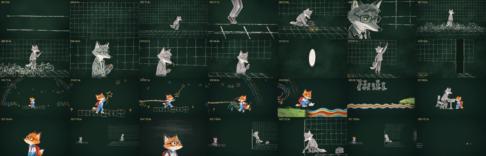

# 《违背的青春》MV

薛之谦《违背的青春》（2018）前半段 0:00–2:27 的 MV，非商业二次创作。歌曲和歌词的版权归原权利人所有。

- **现行版**：第 7 版，黑板粉笔画、姿势原画换张，有无字版和歌词版两条。作品库首页可以在线看歌词版预览（`assets/previews/weibei-youth-mv.mp4`）。
- **做法**：沉淀成了方案 `recipes/chalk-pose-mv.md`。
- **为什么做了八版**：见 `retros/2026-11-06-weibei-youth-mv.md`。
- **第 8 版**：都市真人剧，出文本交给 Muse 生成。故事被用户退回（"它是违背的青春呐。根据歌词大意，写个故事。"），目前暂停。



豆包画的姿势原画：一张图是同一个动作的 4 个瞬间，切开后按拍子换张。41 组的总览见 [preview/pose_sheets_all.jpg](preview/pose_sheets_all.jpg)。

 

画这些姿势时给豆包的参考图：两个角色的全身设定图，加一张风格帧（道具和场景照它画）。

  

## 文件地图

| 位置 | 是什么 |
|---|---|
| `brief.md` | 需求卡、评审标准卡、每一版的决定、用户原话和评委意见。**从这里看起** |
| `lyrics_analysis.md` | 逐句歌词解读（"我"和"你"是谁、每句在说什么），用户确认过 |
| `SHOTBOOK.md` | 28 镜分镜本，第 6 版写的，第 7 版沿用 |
| `chalk/` | 第 7 版源码（现行），见下一节 |
| `live-action/` | 第 8 版：都市真人的故事和剧本、资产表、48 镜分镜脚本，是交给 Muse 的文本。故事被退回了，格式可以照用 |
| `design/`、`doubao/` | 豆包提示词：第 5 版剪纸场景和角色、第 6 版粉笔风格帧（`design/style_v6/`） |
| `preview/` | 镜头总览、姿势原画样例和总览、参考图（都是压缩过的小图） |

被淘汰的做法已经从目录里删掉，包括第 5 版 2.5D 剪纸（three.js 纸偶）、第 6 版代码画身子和表情头像、骨骼贴图人偶。它们的源码留在提交 `d64b68d` 里，要看就运行 `git show d64b68d:works/weibei-youth-mv/<路径>`，或者 `git checkout d64b68d -- works/weibei-youth-mv/<目录>`。

### `chalk/`

| 文件 | 作用 |
|---|---|
| `index.html` → `js/film.js` | 28 个镜头，每镜一个函数，按时间画 |
| `js/poses.js` | 姿势原画换张、残影、长条（河）拼接、浪尖高度 |
| `js/world.js` | 黑板上的粉笔世界：格子、跳房子、自行车、星星、擦除 |
| `js/main.js` | 黑板、相机、动态层（颗粒每 2 帧换一套） |
| `js/paint.js` | 粉笔涂色（板擦、镜片里的星星）和粉笔线 |
| `js/chalk.js`、`post.js`、`r2d.js`、`stage.js`、`core/lib.js` | lemo-opuscar 粉笔引擎原文件（MIT，见 `CREDITS`） |
| `design/poses/` | `jobs_*.json` 是豆包提示词；`cut_sheet.py` 切图；`build_poses.py` 生成 `poses.json`（比例、锚点、对齐、淡出）；`gridcut.py` 读锚点坐标 |
| `design/body/` | 角色全身设定图：提示词 `jobs_body.json`，抠底脚本 `key_body.py` |
| `design/make_tex.py` | 从少年头像取笔触纹理 `tex_kid.png`（镜片里的星星用）；头像提示词 `jobs_heads.json` |
| `render.py`、`qc_frames.py`、`review_sheets.py` | 逐帧渲染、自查（静止、跳变、黑帧）、评审联系表 |
| `lyrics_chalk.py`、`lyrics_sheet.py` | 歌词版的粉笔字层（自动选位）；抽查字有没有压到人 |
| `mux.sh`、`mux_lyrics.sh` | 合成无字版、歌词版 |

## 重渲第 7 版

在 `chalk/` 下运行，Python 用 `~/.venvs/mv/bin/python`：

```bash
python render.py out/frames7b 0 147.03 30 6          # 整片 4411 帧；只改一段时先删旧帧，再用 --ranges a-b 30 6
python qc_frames.py out/frames7b                      # 静止、镜头内跳变、黑帧
python review_sheets.py out/frames7b out/review7      # 每镜 8 帧联系表 + 动作连续帧条
bash mux.sh out/frames7b out/chalk_v7.mp4             # 无字版
python lyrics_chalk.py out/frames7b                   # 歌词层 → out/lyr（现行版存在 out/lyr7）
bash mux_lyrics.sh out/frames7b out/chalk_v7_lyrics.mp4
```

## 只在本机、不进仓库的东西

| 东西 | 位置 | 大小 |
|---|---|---|
| 各版成片 mp4、现行版逐帧和歌词层、评审联系表 | `chalk/out/` | 约 12 GB |
| 第 5 版的粗剪和风格帧视频 | `out/v5/` | 约 260 MB |
| 姿势原画、切好的姿势图（重渲必需）、头像、全身设定图 | `chalk/design/**/*.png` | 约 270 MB |
| 第 5 版的豆包场景和角色图、第 6 版风格帧 | `design/`、`characters/`、`doubao/` 里的 png | 约 290 MB |
| 字体 | `chalk/fonts/LXGWWenKai-Medium.ttf` | 25 MB（OFL，可从 LXGW WenKai 发布页下载） |
| 歌曲 | `~/mv-xue/song.mp3` | — |

换机器重渲，要拷 `chalk/design` 和字体，再准备好歌曲。
